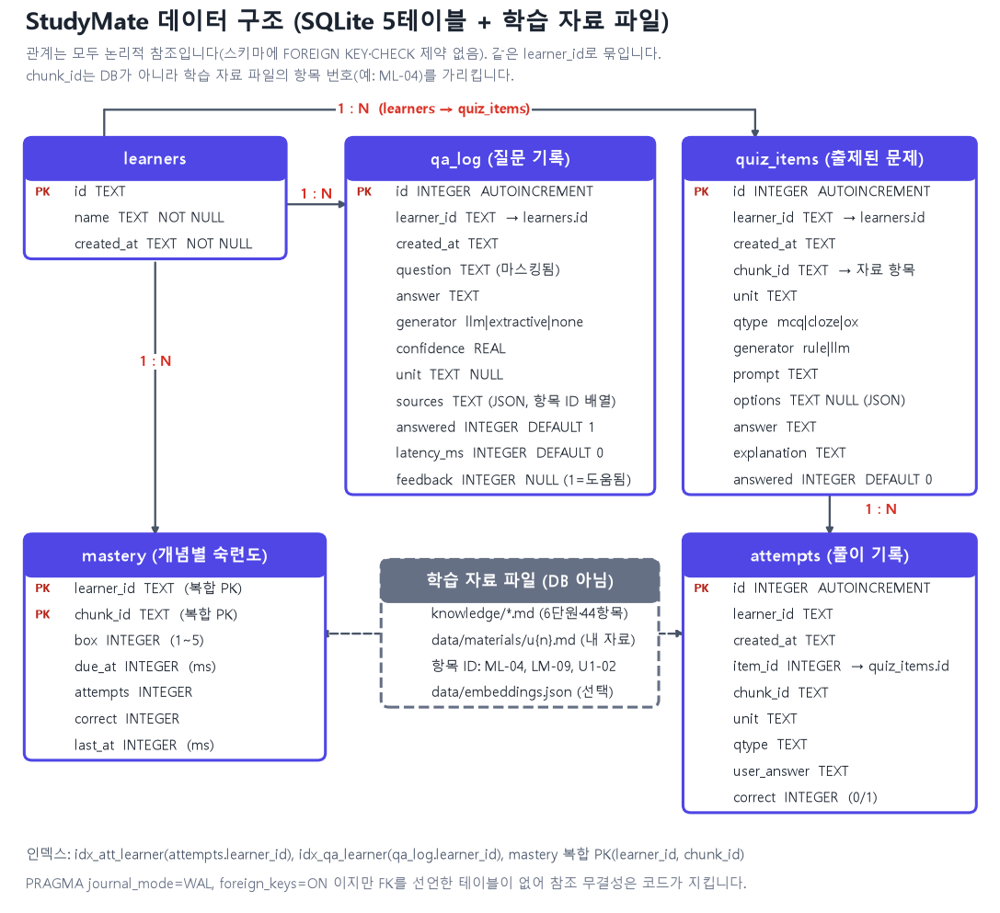

# StudyMate 데이터정의서

작성일 2026-11-26 · 작성자 반재영 · 버전 1.0 · DBMS: SQLite(Node.js 내장 `node:sqlite`) · 구현: `src/db.mjs`(스키마·질의), `src/kb.mjs`(자료 파일)

## 1. 데이터 저장소 개요

StudyMate는 데이터를 세 곳에 둡니다. **DB가 있는 부분은 학습자의 기록뿐**이고, 학습 자료 자체는 DB가 아니라 마크다운 파일입니다.

| 저장소 | 위치 | 내용 | 수명 |
|---|---|---|---|
| SQLite DB | `data/studymate.db`(`DB_FILE`로 변경, 테스트는 `:memory:`) | 학습자·질문 기록·출제 문제·풀이·숙련도 | 지우기 전까지 보관 |
| 학습 자료 파일 | `knowledge/*.md`(기본 6개, 저장소에 포함), `data/materials/u{n}.md`(사용자 추가) | 항목(청크) 원문 | 기본 자료는 영구, 사용자 자료는 삭제 API로 삭제 |
| 임베딩 캐시(선택) | `data/embeddings.json` | `EMBEDDINGS=on`일 때 항목별 벡터. 자료·모델이 바뀌면 해시 키가 달라져 다시 만듦 | 자동 갱신 |
| 메모리(재시작하면 사라짐) | 서버 프로세스 | 항목 목록·검색 색인·요청 간격 기록 | 3장 참고 |

`data/`는 `.gitignore`에 들어 있어 저장소에 올라가지 않습니다. 이 PC의 `data/studymate.db`에는 시연용 데이터(`tools/seed-demo.mjs`)가 들어 있습니다.

## 2. ERD



- 관계는 모두 **논리적 참조**입니다. 스키마에 `FOREIGN KEY`·`CHECK`·`UNIQUE` 제약이 없습니다(`PRAGMA foreign_keys = ON`은 켜져 있지만 선언된 FK가 없어 효과가 없습니다). 그래서 학습자 삭제 시 연쇄 삭제도 없고, 소유자 확인(남의 문제·질문 접근 차단)과 1회 채점 같은 규칙은 **코드가 지킵니다**.
- 같은 `learner_id`로 `qa_log`·`quiz_items`·`attempts`·`mastery`가 묶이고, `attempts.item_id`는 `quiz_items.id`를 가리킵니다.
- `chunk_id`는 DB 테이블이 아니라 학습 자료 파일의 항목 ID(예: `ML-04`, 사용자 자료는 `U1-02`)입니다. 자료가 삭제되면 `quiz_items`·`attempts`·`mastery`에 사라진 ID가 남을 수 있고, 학습현황 계산은 자료에 없는 ID를 건너뜁니다.

## 3. 테이블 목록

| 테이블 | 설명 | 주요 관계 |
|---|---|---|
| learners | 학습자(브라우저가 만든 임의 ID 또는 카카오 ID의 해시)와 표시 이름 | 1:N qa_log, quiz_items, attempts, mastery |
| qa_log | 챗봇 질문 한 건과 답변·생성 방식·신뢰도·응답 시간·피드백 | N:1 learners |
| quiz_items | 출제된 문제 한 건(정답·해설 포함)과 채점 여부 | N:1 learners, 1:N attempts |
| attempts | 채점된 풀이 한 건 | N:1 quiz_items, learners |
| mastery | 학습자 × 개념(항목) 숙련 상태(라이트너 상자·복습 시점) | N:1 learners |

## 4. 테이블 정의

### 4.1 learners
| 컬럼 | 타입 | 키 | NULL | 설명 |
|---|---|---|---|---|
| id | TEXT | PK | N | 학습자 ID. 브라우저는 `l-` + 난수 20자(시연은 `demo-learner-01`), 카카오는 `kakao-` + 사용자 ID의 SHA-256 앞 24자. API는 `^[\w-]{6,64}$`만 허용 |
| name | TEXT | | N | 표시 이름. 입력이 없으면 `학습자`. 제어문자·`<`·`>` 제거, 최대 20자 |
| created_at | TEXT | | N | 생성 시각(ISO 8601, UTC) |

### 4.2 qa_log
| 컬럼 | 타입 | 키 | NULL | 설명 |
|---|---|---|---|---|
| id | INTEGER | PK(자동증가) | N | 질문 번호(응답의 `id`, 피드백 대상) |
| learner_id | TEXT | (→ learners.id) | N | 질문한 학습자. 인덱스 `idx_qa_learner` |
| created_at | TEXT | | N | 질문 시각 |
| question | TEXT | | N | **개인정보가 마스킹된** 질문(2~500자) |
| answer | TEXT | | N | 사용자에게 보인 답변(거절 문구 포함) |
| generator | TEXT | | N | `llm` AI 답변(검사 통과) · `extractive` 자료 원문 발췌 · `none` 근거 없음(거절) |
| confidence | REAL | | N | 검색 신뢰도(0~1, 저장은 반올림 전 값) |
| unit | TEXT | | Y | 답변한 질문의 단원. 거절(`none`)이면 NULL |
| sources | TEXT | | N | 근거로 보여 준 항목 ID의 JSON 배열(기본 `[]`) |
| answered | INTEGER | | N | 1 답변함 · 0 거절(기본 1). "근거 있는 답변 비율"의 분자 |
| latency_ms | INTEGER | | N | 처리 시간(기본 0) |
| feedback | INTEGER | | Y | 1 도움됨 · 0 아쉬움 · NULL 평가 안 함 |

### 4.3 quiz_items
| 컬럼 | 타입 | 키 | NULL | 설명 |
|---|---|---|---|---|
| id | INTEGER | PK(자동증가) | N | 문제 번호 |
| learner_id | TEXT | (→ learners.id) | N | 이 문제를 받은 학습자(남의 문제를 풀면 404) |
| created_at | TEXT | | N | 출제 시각 |
| chunk_id | TEXT | (→ 자료 항목) | N | 문제의 근거가 된 항목 ID |
| unit | TEXT | | N | 단원 |
| qtype | TEXT | | N | `mcq` 객관식 · `cloze` 빈칸 · `ox` O/X |
| generator | TEXT | | N | `rule` 규칙 기반 · `llm` AI 출제(검사 통과분) |
| prompt | TEXT | | N | 문제 본문(정답 비노출) |
| options | TEXT | | Y | 보기의 JSON 배열(객관식 4개, O/X는 `["O","X"]`, 빈칸은 NULL) |
| answer | TEXT | | N | 정답(응답으로 문제를 줄 때는 제외) |
| explanation | TEXT | | N | 해설(정답 + 원문) |
| answered | INTEGER | | N | 0 미제출 · 1 채점됨(기본 0). 한 문제를 한 번만 채점하는 표시 |

### 4.4 attempts
| 컬럼 | 타입 | 키 | NULL | 설명 |
|---|---|---|---|---|
| id | INTEGER | PK(자동증가) | N | 풀이 번호 |
| learner_id | TEXT | (→ learners.id) | N | 풀이한 학습자. 인덱스 `idx_att_learner` |
| created_at | TEXT | | N | 제출 시각 |
| item_id | INTEGER | (→ quiz_items.id) | N | 대상 문제 |
| chunk_id | TEXT | (→ 자료 항목) | N | 항목 ID(집계용으로 복사 저장) |
| unit | TEXT | | N | 단원(집계용 복사) |
| qtype | TEXT | | N | 문제 유형(복사) |
| user_answer | TEXT | | N | 제출한 답(200자까지) |
| correct | INTEGER | | N | 1 정답 · 0 오답 |

### 4.5 mastery
| 컬럼 | 타입 | 키 | NULL | 설명 |
|---|---|---|---|---|
| learner_id | TEXT | PK(복합) | N | 학습자 |
| chunk_id | TEXT | PK(복합) | N | 개념(항목) ID |
| box | INTEGER | | N | 라이트너 상자 1~5. 정답이면 +1(최대 5), 오답이면 1. 4 이상을 "숙련"으로 셈 |
| due_at | INTEGER | | N | 다음 복습 시점(에포크 밀리초) = 풀이 시각 + 상자별 간격(1상자 0일·2상자 1일·3상자 3일·4상자 7일·5상자 14일) |
| attempts | INTEGER | | N | 누적 시도(기본 0, 첫 풀이에 1) |
| correct | INTEGER | | N | 누적 정답(기본 0) |
| last_at | INTEGER | | N | 마지막 풀이 시각(에포크 밀리초) |

`attempts`·`correct`는 `INSERT … ON CONFLICT(learner_id, chunk_id) DO UPDATE`로 누적합니다. 학습현황·추천·약점 복습 출제는 이 표의 평활 정답률 `(correct+1)/(attempts+2)`을 씁니다.

## 5. 학습 자료 파일 구조 (DB 아님)

### 5.1 항목(청크) 형식
```
# 단원 제목                     ← 첫 번째 '# ' 줄이 단원 이름
## [ML-04] 과대적합과 과소적합    ← '## [ID] 제목' 한 개 = 항목 한 개
**과대적합**은 모델이 학습 데이터에는 … ← 본문. **굵은 글씨** = 핵심 용어
```

| 필드(메모리 객체) | 설명 |
|---|---|
| id | 항목 ID. 형식 `[A-Z]+\d*-\d+`. 기본 자료는 PY·DA·ML·DL·LM·WB 접두사, 사용자 자료는 `U{n}-{두 자리}` |
| title · text | 제목, 본문(`**` 제거) |
| unit · unitTitle · file | 파일 이름(확장자 제외)·단원 제목·원본 파일 |
| user | 사용자가 추가한 자료인지 |
| terms · derivedTerms | 핵심 용어 목록. 굵은 글씨가 없으면 드문 단어 최대 3개를 자동 선정하고 `derivedTerms=true` |

### 5.2 기본 자료 현황 (직접 요약해 쓴 자료, 실제 수업 교재 아님)
| 단원(파일) | 제목 | 항목 수 |
|---|---|---|
| python | 파이썬 기초 | 7 |
| data | 데이터 처리와 분석 | 6 |
| ml | 머신러닝 기초 | 8 |
| dl | 딥러닝 기초 | 7 |
| llm | LLM과 RAG | 9 |
| web | 웹, 데이터베이스, IoT | 7 |
| 합계 | 6개 단원 | **44** |

### 5.3 사용자 자료 파일
`POST /api/materials`가 `data/materials/u{n}.md`를 만듭니다(`n`은 기존 최대 번호 + 1). 제목 2자 이상(60자까지), 내용 40자 이상 30,000자 이하. `## 제목`이 있으면 그 단위로 항목을 만들고(본문 10자 미만 제외), 없으면 문단을 모아 200~600자 정도로 나눕니다. **자료함은 학습자별이 아니라 서버 전체가 공유**하며, 삭제는 `u숫자` 형식 파일만 가능합니다(기본 자료는 삭제 불가).

### 5.4 임베딩 캐시 `data/embeddings.json` (선택)
`{ key, vectors }`. `key`는 임베딩 모델 이름과 전체 항목 텍스트의 SHA-256이라 자료가 바뀌면 캐시를 쓰지 않고 다시 만듭니다. Ollama가 없으면 파일을 만들지 않고 BM25만 씁니다. 이 PC에서는 임베딩을 검증하지 못했습니다.

## 6. 인덱스

| 인덱스 | 대상 | 용도 |
|---|---|---|
| idx_att_learner | attempts(learner_id) | 학습자별 풀이 집계(진도·최근 풀이) |
| idx_qa_learner | qa_log(learner_id) | 학습자별 질문 수·최근 질문(대화 맥락) |
| (자동) PK | learners(id), mastery(learner_id, chunk_id) | 학습자 조회, 개념별 UPSERT |

`quiz_items`·`qa_log`의 `id`는 `INTEGER PRIMARY KEY`라 별도 인덱스 없이 조회됩니다. 현재 데이터 규모(시연 기준 수십~수백 행)에서는 충분하지만, 규모가 커지면 `attempts(unit)`·`attempts(chunk_id)` 같은 전체 집계용 인덱스를 검토해야 합니다(전체 집계 쿼리 `stats()`는 인덱스 없이 전체 테이블을 훑습니다).

## 7. 메모리 데이터 구조 (서버 재시작 시 초기화)

| 구조 | 위치 | 내용 |
|---|---|---|
| 항목 목록·단원 목록 | `svc.kb`(app.mjs) | 파일에서 읽은 항목. 자료를 추가·삭제하면 다시 읽음 |
| 검색 색인 | `Retriever`(rag.mjs) | 항목별 토큰 빈도(`tf`)·길이, 토큰별 문서 빈도(`df`), (선택) 벡터 |
| 질문 간격 기록 | `lastAsk`(http.mjs)·`kakaoLastAsk` | 학습자별 마지막 질문 시각. 0.8초 간격 제한용, 5,000개를 넘으면 비움 |
| LLM 상태 | `LLM`(llm.mjs) | 선택된 공급자·모델·마지막 오류(키는 포함하지 않음) |

## 8. 데이터 관리 정책

| 항목 | 정책 |
|---|---|
| 질문 개인정보 | 주민등록번호·카드번호·전화번호·이메일을 `[주민번호]` 등으로 바꾼 뒤 검색·LLM 전송·DB 저장. **이 4종 밖의 개인정보(이름·주소 등)는 가려지지 않음** |
| 외부 전송 | Claude·ChatGPT를 쓰면 마스킹된 질문과 검색된 자료 일부가 해당 회사 API로 전송됨. 로컬 Ollama는 외부로 나가지 않음. 자료함에 개인정보·비공개 자료를 올리지 않도록 안내 |
| 카카오 사용자 ID | 원문을 저장하지 않고 SHA-256 해시(앞 24자)로만 저장 |
| API 키 | `.env`·환경변수에서만 읽음. 로그·응답·오류 메시지에 포함하지 않음(테스트로 확인). `.env`는 git 제외 |
| 정답 노출 | `quiz_items.answer`는 DB에만 있고 출제 응답에는 포함하지 않음. 채점 응답에서만 공개 |
| 1회 채점 | `quiz_items.answered`를 조건부 UPDATE(`WHERE answered = 0`)로 선점해 중복 제출이 기록을 부풀리지 못하게 함 |
| 소유자 격리 | 문제 채점·피드백은 `learner_id`가 일치할 때만 처리, 아니면 404 |
| 학습자 인증 | **없음.** ID를 아는 사람은 해당 학습자의 학습현황을 조회할 수 있음(교육용 데모) |
| 보존·삭제 | 사용자가 지우는 기능은 자료함(자료 파일)뿐이며 **학습자 기록을 지우는 API는 없음**. 보존 기간 정책도 정하지 않았음(후속 과제) |
| 저널 | SQLite WAL 모드(`-wal`·`-shm` 파일이 함께 생김). 백업 시 세 파일을 함께 복사 |
| 시연 데이터 | `tools/seed-demo.mjs`가 데모 학습자 2명의 질문·풀이를 시드 고정 난수로 넣음. 화면의 정답률·만족도는 실제 학습 효과가 아님 |
