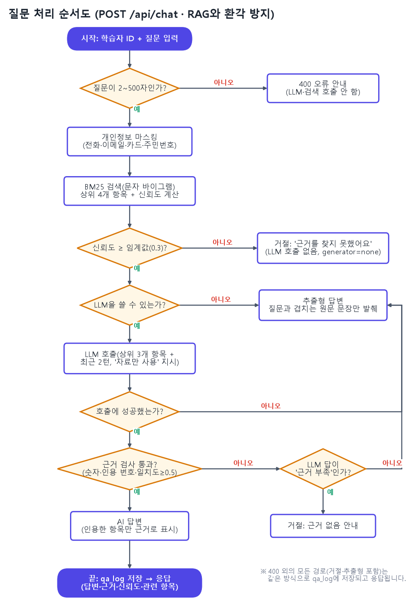

# StudyMate 요구사항 분석서

작성일 2026-11-26 · 작성자 반재영 · 버전 1.0 · 과목: 인공지능 응용 시스템 개발 종합 프로젝트

> 이 문서는 현재 코드(`src/`, `public/`, `test/`)와 평가 원자료(`evidence/`)를 확인해 작성했습니다. 기획서(11/24)·결과보고서(11/24)와 코드가 다른 곳은 **코드를 기준**으로 했고, 달라진 부분은 12장에 모아 두었습니다.

## 목차
1. 개요 · 2. 시스템 범위와 이해관계자 · 3. 현황 분석과 문제 정의 · 4. 사용자 요구 분석 · 5. 기능 요구사항 분석 · 6. 비기능 요구사항 분석 · 7. 제약 사항과 가정 · 8. 유스케이스 · 9. 우선순위 · 10. 추적성 · 11. 위험 분석 · 12. 기존 문서와 코드의 불일치

## 1. 개요

### 1.1 목적
학습 자료를 근거로 질문에 답하고, 자료에서 퀴즈를 만들어 약한 개념을 찾아 복습 순서를 추천하는 StudyMate의 요구사항을 분석하고, 구현·시험의 기준으로 삼는다.

### 1.2 시스템 개요
학습자가 `knowledge/`의 기본 자료(6개 단원, 44개 항목)나 직접 추가한 자료에 대해 질문하면, 시스템이 BM25로 관련 항목을 찾아 **근거와 함께** 답한다. 검색 신뢰도가 낮으면 답하지 않고, LLM(Claude·ChatGPT·로컬 Ollama 중 연결된 것)이 있으면 답변을 만들되 숫자·인용·자료 일치도를 검사한 뒤에만 내보낸다. 같은 자료로 객관식·빈칸·O/X 퀴즈를 만들고 채점하며, 풀이 기록(SQLite)으로 개념별 숙련도를 관리해 약점과 복습 시점을 알려 준다. LLM이 없어도 모든 기능이 동작한다(추출형 답변, 규칙 기반 퀴즈).

### 1.3 용어
| 용어 | 뜻 |
|---|---|
| 항목(청크) | `## [ID] 제목`으로 나뉜 자료의 한 덩어리. 검색·퀴즈·숙련도의 기본 단위(예: `ML-04`) |
| 단원(unit) | 자료 파일 하나(`ml`, `python` …). 사용자 자료는 `u1`, `u2` … |
| 핵심 용어 | 자료의 **굵은 글씨**. 퀴즈의 정답·오답 보기 후보. 굵은 글씨가 없는 자료는 드문 단어를 자동 선정 |
| 신뢰도 | 검색 결과가 질문에 얼마나 근거가 되는지(0~1). 임계값(0.3) 미만이면 답하지 않음 |
| 생성 방식(generator) | `llm` AI 답변(검사 통과) · `extractive` 자료 원문 발췌 · `none` 근거 없음(거절) |
| 환각 방지 검사 | 답변의 숫자·인용 번호·자료 일치도(≥0.5)를 검사. 실패하면 원문으로 대체 |
| 라이트너 상자 | 개념별 숙련 단계 1~5. 맞히면 +1, 틀리면 1로. 복습 간격 0·1·3·7·14일 |
| 평활 정답률 | (정답+1)/(시도+2). 시도가 적을 때 과신하지 않기 위한 값 |
| 추출형 답변 | LLM 없이 질문과 겹치는 원문 문장만 골라 보여 주는 답변 |

## 2. 시스템 범위와 이해관계자

| 구분 | 내용 |
|---|---|
| 범위 안 | 자료 기반 Q&A(RAG), 근거 부족 거절, 환각 방지 검사, LLM 선택·대체, 개인정보 마스킹, 퀴즈 출제·채점, 학습 분석·복습 추천, 자료함(추가·삭제), 운영 지표, 카카오톡 스킬 서버 |
| 범위 밖 | 로그인·권한, PDF 업로드(텍스트로 붙여 넣기만), 서술형 채점(LLM 채점), 학습 경로(선수 관계) 추천, 부하·동시접속 대응, 모바일 앱 |

| 이해관계자 | 관심사 |
|---|---|
| 학습자 | 믿을 수 있는 설명(출처 확인), 내가 모르는 곳 파악, 내 노트로 공부 |
| 교수자·운영자 | 많이 묻는 단원, 정답률이 낮은 개념 파악 |
| 개발자(본인) | 환각 방지, LLM 없이도 동작, 측정으로 검증 가능한 품질 |
| 평가자(강사) | 요구사항–설계–시험의 일관성, 측정 결과의 정직성 |

## 3. 현황 분석과 문제 정의

| 현황 | 문제 | StudyMate의 대응 |
|---|---|---|
| 학습 자료가 여러 곳에 흩어짐 | 필요한 설명을 찾는 데 시간이 듦 | 6개 단원 자료를 한곳에서 검색, 내 노트 추가 |
| 일반 챗봇은 수업 자료와 무관하게 답함 | 자료와 다른 설명, 없는 내용을 지어냄(환각) | 자료 안에서만 답하게 지시, 숫자·인용·일치도 검사, 근거 항목 표시 |
| 공부한 뒤에도 약한 개념을 모름 | 복습 순서를 정하기 어려움 | 퀴즈 풀이로 개념별 숙련도 계산, 약점·복습 시점 추천 |
| 외부 LLM이 없거나 느린 환경(발표장) | 시연 실패 위험 | LLM 없이도 추출형 답변·규칙 기반 퀴즈로 동작 |
| 질문에 개인정보가 섞일 수 있음 | 저장·외부 전송 시 유출 | 전화·이메일·카드·주민번호를 저장·LLM 전달 전에 마스킹 |

## 4. 사용자 요구 분석

| ID | 사용자 요구 |
|---|---|
| UN-01 | 내 자료에 있는 내용은 **출처(근거 항목)와 함께** 답해 주길 원한다 |
| UN-02 | 자료에 없는 질문에는 지어내지 말고 "근거를 찾지 못했다"고 하길 원한다 |
| UN-03 | AI 답변이 맞는지 **원문을 직접 확인**하고 싶다 |
| UN-04 | 자료에서 퀴즈가 자동으로 만들어지고, 정답이 문제에 드러나지 않으며, 채점·해설을 받길 원한다 |
| UN-05 | 내가 어디를 모르는지(약한 개념)와 무엇부터 복습할지 알고 싶다 |
| UN-06 | 내 노트를 추가하면 곧바로 질문·퀴즈에 쓰이길 원한다 |
| UN-07 | AI 서비스(키·인터넷)가 없어도 쓸 수 있길 원한다 |
| UN-08 | 질문 속 개인정보가 저장·외부 전송되지 않길 원하고, API 키가 노출되지 않길 원한다 |
| UN-09 | (교수자) 많이 묻는 단원과 정답률이 낮은 개념을 보고 싶다 |
| UN-10 | 카카오톡 챗봇으로도 같은 답을 받고 싶다 |

## 5. 기능 요구사항 분석

| 영역 | 요구 | 핵심 판단 |
|---|---|---|
| 자료·검색 | 자료를 항목으로 나눠 검색하고 신뢰도 계산 | 한국어 형태소 분석기 없이 **어절 + 문자 바이그램**으로 조사 변화에 대응. 군말("알려줘")은 검색에서 제외, 자료에 없는 어절이 많으면 신뢰도를 깎음 |
| 답변 | 근거와 함께 답하고, 근거가 없으면 거절 | 신뢰도 임계값 0.3을 **평가 세트로 비교해 선택**(0.2 → 0.3에서 범위 밖 거절 65% → 85%) |
| 환각 방지 | LLM 답을 그대로 믿지 않음 | 3겹: 신뢰도 임계값 → LLM "근거 부족" 응답 → 숫자·인용·일치도 검사. 실패하면 원문 발췌. 검사로 못 거르는 경우(의미 반대, 범위 밖 질문의 일부)는 한계로 인정 |
| LLM 선택 | 키·서버가 있는 공급자를 자동 선택 | Claude → ChatGPT → Ollama 순(`auto`). 호출이 실패해도 추출형으로 응답 |
| 퀴즈 | 정답 비노출, 보기에 정답 포함, 문제당 1회 채점 | 규칙 기반(빈칸·객관식·O/X)이 기본. AI 출제는 클라우드 LLM에서만, 검사를 통과한 문제만 채택 |
| 학습 분석 | 개념별 숙련도로 약점·복습 추천 | 라이트너 상자 + 평활 정답률 + 복습 시점. 안 푼 개념은 중간 우선순위(0.6) |
| 자료함 | 사용자 자료를 즉시 반영 | `## 제목`으로 나누고 `**용어**`를 핵심 용어로. 업로드 후 색인을 다시 만듦. 기본 자료는 삭제 불가 |
| 운영 지표 | 질문·정답률 집계 | 질문 수, 근거 있는 답변 비율, 평균 응답시간, 도움됨 비율, 단원별 질문·정답률 |
| 카카오톡 | 스킬 서버 형식 응답 | 5초 제한 대응(4.5초), 오류도 HTTP 200, 사용자 ID는 해시 |

## 6. 비기능 요구사항 분석

| 분류 | 요구 |
|---|---|
| 가용성 | LLM이 없거나 실패해도 모든 기능 동작(추출형 답변, 규칙 기반 퀴즈) |
| 개인정보 | 질문의 개인정보는 저장·LLM 전달 전에 마스킹, 카카오 사용자 ID는 해시 저장, 서버는 기본 127.0.0.1에서만 열림 |
| 보안 | API 키는 환경변수(`.env`)로만 읽고 오류·응답에 노출하지 않음, 입력 길이·본문 크기 제한, 학습자별 질문 속도 제한(0.8초), 화면 `textContent`(XSS), 정적 파일 경로 이탈 차단 |
| 정직성 | 답변마다 생성 방식·신뢰도·근거 항목을 표시. 평가의 한계를 문서에 명시 |
| 재현성 | 평가·시연 데이터는 시드 고정으로 같은 결과 재현(`tools/eval.mjs`, `tools/seed-demo.mjs`) |
| 이식성 | Node.js 24 이상, 외부 npm 패키지 없음 |
| 유지보수 | 자동 테스트 30개(`npm test`) |
| 사용성 | 모바일 폭에서도 사용 가능한 반응형 화면 |
| 성능 | **목표 수치를 정하지 않았다.** 측정값만 보고(로컬 3B LLM 기준 응답 중앙값 2.55초, 12장·결과 참고). 부하·동시접속은 미측정 |

## 7. 제약 사항과 가정

- 개인 프로젝트(1인), 기획서 제출 12/04, 최종 발표 12/30. 외부 npm 패키지 없이 Node.js 24 내장 기능(`node:sqlite`, `node:test`, `fetch`)만 사용.
- 기본 학습 자료(44개 항목)는 **직접 요약해 쓴 자료**이며 실제 수업 교재가 아니다. 평가 질문(92개)도 같은 사람이 작성했으므로 수치는 낙관적일 수 있다.
- 이 개발 환경에는 Claude·ChatGPT API 키가 없어 **실호출을 검증하지 못했다**(가짜 서버로 요청 형식만 검증). 로컬 Ollama(`kanana2:3b`, 3B급)로만 실제 LLM 답변을 측정했다.
- 카카오 i 오픈빌더 실제 채널 연결도 검증하지 못했다(요청·응답 형식을 자동 테스트로만 확인).
- 로그인이 없고 학습자는 브라우저의 임의 ID로 구분한다(교육용 데모).

## 8. 유스케이스

| ID | 유스케이스 | 주 흐름 | 예외 |
|---|---|---|---|
| UC-01 | 질문하기 | 질문 입력(+설명 수준) → 마스킹 → 검색 → 신뢰도 판정 → 답변 + 근거 칩·신뢰도·관련 항목 | 2~500자가 아니면 400, 0.8초 안에 재질문 429 |
| UC-02 | 근거 확인 | 근거 칩 클릭 → 원문 항목 펼침 | – |
| UC-03 | 범위 밖 질문 | 신뢰도 < 0.3 → "근거를 찾지 못했어요" + 자료 추가 안내 | 신뢰도를 넘는 범위 밖 질문은 원문이 나갈 수 있음(알려진 한계) |
| UC-04 | 피드백 | 👍/👎 → 운영 지표의 도움됨 비율에 반영 | 남의 질문이면 404 |
| UC-05 | 퀴즈 풀기 | 단원·문항 수 선택 → 문제 → 답 제출 → 정답·해설·다음 복습 시점 | 같은 문제 재제출 409, 남의 문제 404 |
| UC-06 | 약점 복습 | 약점 복습 모드 → 틀린 개념·복습 시점 도래 개념 우선 출제 | – |
| UC-07 | 학습현황 보기 | 단원별 정답률, 약점 개념(원문 펼침), 오늘의 학습 추천 | 기록이 없으면 안내 문구 |
| UC-08 | 자료 추가·삭제 | 제목+텍스트 붙여 넣기(또는 .txt/.md) → 항목 생성 → 즉시 검색·퀴즈 반영 / 내 자료만 삭제 | 제목 2자 미만·내용 40자 미만·3만 자 초과 400, 기본 자료 삭제 404 |
| UC-09 | 운영 지표 확인 | 질문 수·답변 비율·응답시간·단원별 지표 보기 | – |
| UC-10 | 카카오톡 질문 | 오픈빌더 → `POST /kakao/skill` → 답변 + "📚 근거" + 빠른 답장 | 4.5초 초과 시 안내 문구, 토큰 불일치 401 |

### 8.1 처리 순서도

## 9. 요구사항 우선순위 (MoSCoW)

| 구분 | 요구사항 |
|---|---|
| Must | FR-01~04, FR-06, FR-08~12, FR-13, NFR-01·02·03·04·05 |
| Should | FR-05(LLM 선택), FR-07(설명 수준), FR-14·15(피드백·운영 지표), FR-16(카카오 스킬), FR-17(웹 화면), NFR-06~10 |
| Could | 임베딩 혼합 검색(`EMBEDDINGS=on`, 미검증) |
| Won't | 로그인·권한, PDF 업로드, LLM 서술형 채점, 학습 경로 추천 |

> FR/NFR 번호의 정의는 「요구사항 명세서」를 참조합니다.

## 10. 추적성

| 사용자 요구 | 기능 요구 | 설계 요소 | 시험 |
|---|---|---|---|
| UN-01 | FR-02·03 | rag.mjs, text.mjs, chat.mjs | 검색 1위 테스트, 평가 hit@1 |
| UN-02 | FR-04·06 | chat.mjs(임계값), guard.mjs | 범위 밖 거절 테스트, 평가 거절률 |
| UN-03 | FR-03·06 | sources 반환, 추출형 답변 | 추출형·근거 포함 테스트 |
| UN-04 | FR-09·10 | quiz.mjs | 정답 비노출·채점·중복 제출 테스트, 퀴즈 구조 검사 132문제 |
| UN-05 | FR-11·12 | learning.mjs, db.mjs(mastery) | 약점·상자 상승·복습 우선 출제 테스트 |
| UN-06 | FR-13 | kb.mjs | 자료 추가·삭제 테스트 |
| UN-07 | FR-05, NFR-01 | llm.mjs, guard.mjs | LLM 실패 시 추출형 테스트 |
| UN-08 | FR-08, NFR-02·04 | text.mjs(maskPII), llm.mjs, kakao.mjs | 마스킹·키 비노출·ID 해시 테스트 |
| UN-09 | FR-14·15 | db.mjs(stats) | 챗봇→피드백→학습현황→지표 흐름 테스트 |
| UN-10 | FR-16 | kakao.mjs | 카카오 스킬 테스트 2개 |

## 11. 위험 분석

| 위험 | 가능성 | 영향 | 대응 |
|---|---|---|---|
| 범위 밖 질문 일부가 거절되지 않음(실측 3/20) | 확인됨 | 관련 없는 원문이 답으로 나감 | 3겹 방어 + 한계 명시. 더 큰 모델·문장 단위 근거 검증은 12월 과제 |
| 돌려 말한 질문을 어휘 검색이 놓침(어려운 질문 hit@1 83.3%) | 중간 | 엉뚱한 근거 | hit@4는 100%, 임베딩 혼합(미검증)·재순위화 검토 |
| Claude·ChatGPT 실호출이 요청 형식·모델 ID와 맞지 않을 수 있음 | 중간 | 연동 실패 → 추출형으로 대체됨 | 12/05~16에 키를 넣어 실호출 검증. 실패해도 서비스는 동작 |
| 소형 LLM이 조건을 빠뜨리거나 의미가 반대인 답을 냄 | 중간 | 틀린 설명 | 검사로 못 거르는 경우가 있음을 명시, 근거 원문을 항상 함께 표시 |
| 평가가 자체 작성 자료·질문이라 낙관적 | 높음 | 성능 과대평가 | 상한선으로 표기, 12월 별도 검증 세트·실제 교재로 재평가 |
| 로그인이 없어 ID를 알면 남의 기록을 볼 수 있음 | 중간(데모) | 학습 기록 노출 | 교육용 데모로 명시, 후속 과제로 인증 |
| 외부 LLM으로 개인정보 전송 | 낮음~중간 | 마스킹 규칙 밖의 정보 유출 | 4종(전화·이메일·카드·주민번호) 마스킹, 자료함에 개인정보를 올리지 않도록 안내, 로컬 Ollama 선택 가능 |

## 12. 기존 문서와 코드의 불일치 (코드를 기준으로 함)

| # | 내용 | 확인한 사실 |
|---|---|---|
| 1 | 결과보고서 3.1의 기능 달성표는 F1~F12만 있고 **카카오톡 스킬 서버(F13)가 없음** | 기획서·README·코드(`src/kakao.mjs`)·테스트 2개에는 있음. 본 문서는 FR-16으로 포함 |
| 2 | 결과보고서 4장의 테스트 표에 카카오 테스트가 언급되지 않음 | 30개 중 2개가 카카오 스킬 테스트(2026-11-26 재실행 30/30 통과) |
| 3 | 응답 시간 중앙값이 결과보고서 2.6초, 발표 PPT 2.5초로 다름 | 원자료 `evidence/eval-llm.json`의 `medianMs`는 2,550ms. 본 문서는 **2.55초(2,550ms)** 로 표기 |
| 4 | 신뢰도 임계값 기본값이 코드에 2곳 | `ChatService` 생성자 기본값 0.2, 실제 서버를 조립하는 `createServices` 기본값 0.3. 실행 중인 서비스·평가·테스트는 **0.3** |
| 5 | 기획서 4.4 데이터 설계에 인덱스·제약 정보가 없음 | 스키마에는 인덱스 2개(`idx_att_learner`, `idx_qa_learner`)가 있고 FOREIGN KEY·CHECK는 **없음**(`PRAGMA foreign_keys=ON`은 켜져 있으나 선언된 FK가 없음) |
| 6 | 결과보고서 제출물 목록에 요구사항·데이터·일정 문서 등이 없음 | 본 문서 묶음(`docs/README.md`)이 추가분을 정리 |
