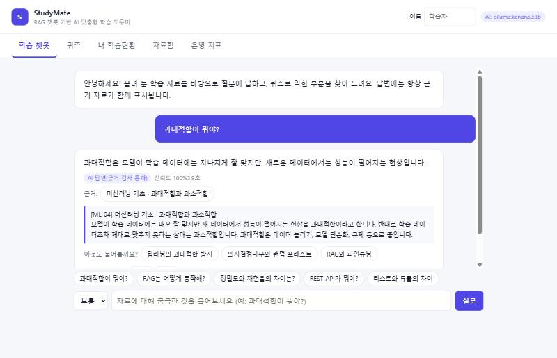
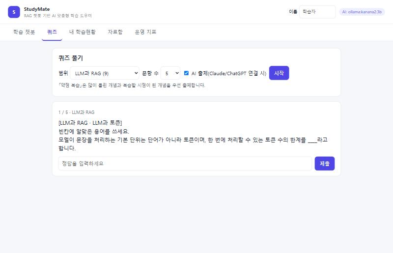
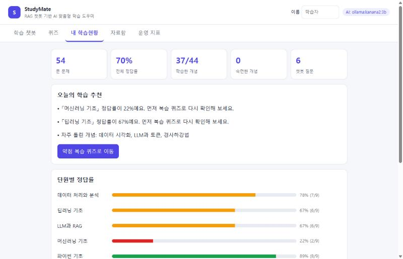
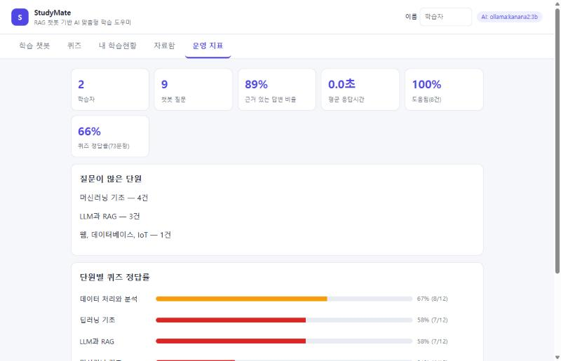
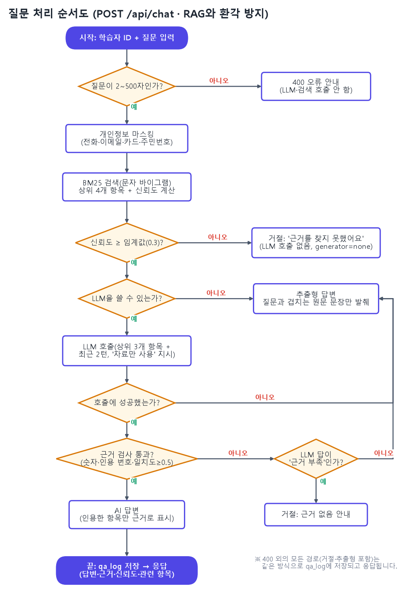
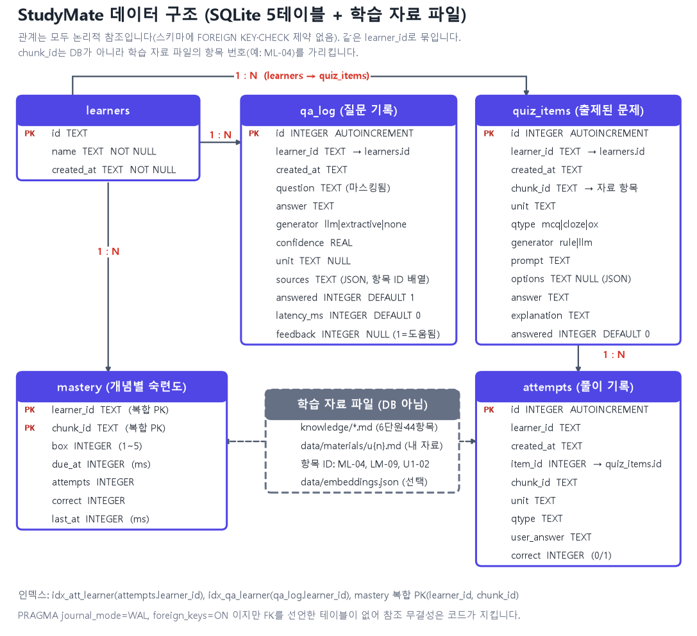

# 포트폴리오 — StudyMate

## 한 줄 소개
내 학습 자료를 **근거로만** 답하고(근거 항목·원문·신뢰도 표시), 자료에 없는 질문은 지어내지 않고 거절하며, 자료에서 퀴즈를 만들어 채점한 뒤 **풀이 기록으로 약한 개념과 복습 순서를 추천**하는 RAG 학습 도우미. LLM이 없어도 동작합니다.

## 프로젝트 정보
| 항목 | 내용 |
|---|---|
| 작성자 | 반재영 (개인 프로젝트, 기획·설계·구현·테스트·문서 전 과정) |
| 과목 | 인공지능 응용 시스템 개발 종합 프로젝트 |
| 기간 | 2026.11.24 ~ 12.30 (기획서 12/04, 최종 발표 12/30). 이 문서는 11/26 기준 |
| 기술 | Node.js 24, SQLite(`node:sqlite`), BM25(문자 바이그램), Claude·ChatGPT·Ollama(`kanana2:3b`) 어댑터, 바닐라 JS, 외부 npm 패키지 0개 |
| 코드 | `projects/StudyMate` (`src/` 13개 모듈, 화면 `public/`, 자동 테스트 30개, 평가 도구 `tools/eval.mjs`) |
| 상태 | 프로젝트는 JobMate로 대체되었고, 이 문서는 StudyMate를 같은 문서 체계로 정리한 것 |

## 문제와 해결
- **문제**: 학습 자료는 흩어져 있고, 공부한 뒤에도 어디가 약한지 알기 어렵다. 일반 챗봇은 수업 자료와 다른 설명을 하거나 없는 내용을 그럴듯하게 지어낸다(환각).
- **해결**: 질문 → 개인정보 마스킹 → BM25 검색과 신뢰도 → (임계값 미만이면 거절) → LLM 답변 → **숫자·인용·자료 일치도 검사** → 통과하면 AI 답변, 실패하면 자료 원문 발췌. 같은 자료로 퀴즈를 만들고(객관식·빈칸·O/X, 정답 비노출), 풀이 기록으로 라이트너 상자와 평활 정답률을 계산해 약점·복습 시점을 추천합니다.

## 핵심 성과
| 항목 | 결과 | 근거 |
|---|---|---|
| 검색 정확도(일반 질문 60개) | hit@1 **100.0%** (60/60), hit@4 100%, MRR 1 | `evidence/eval.json` |
| 검색 정확도(돌려 말한 어려운 질문 12개) | hit@1 **83.3%** (10/12), hit@4 100% | 같음 |
| 범위 밖 질문 20개 거절 | **85.0%** (17/20) — 임계값 0.2일 때 65% → 0.3으로 개선. 3개는 거절 못 함(미해결) | 같음, `eval-llm.json` |
| 실제 LLM(로컬 Ollama 3B) 80문항 | AI 답변 55 · 근거 검사 탈락해 원문 발췌 5 · 일반 질문 거절 0, 정답 항목 인용 60/60, 응답 중앙값 2.55초·p90 5.27초 | `evidence/eval-llm.json` |
| 퀴즈 구조 검사(132문제) | 정답 노출 0 · 보기 누락 0 · 보기 중복 0 · 생성 실패 항목 0 | `evidence/eval.json` |
| 자동 테스트 | **30/30 통과** (11/26 재실행, 약 0.5초) | `evidence/test-result.txt` |
| 재현성 | 평가 결과를 11/26에 다시 돌려 11/24 원자료와 동일함을 확인 | `node tools/eval.mjs` |

이 수치는 **개발자가 직접 쓴 자료(44개 항목)와 질문(92개)** 으로 측정한 것이고 임계값도 같은 세트로 골랐습니다. 실제 학습자 질문에 대한 성능을 보장하지 않습니다.

## 화면
시연 데이터(`tools/seed-demo.mjs`, 데모 학습자 2명)로 캡처한 화면입니다. 정답률·만족도 수치는 실제 학습 효과가 아닙니다.

| 학습 챗봇(답변·근거·신뢰도) | 퀴즈(빈칸) |
|---|---|
|  |  |

| 내 학습현황(약점·오늘의 학습 추천) | 운영 지표 |
|---|---|
|  |  |

## 아키텍처·데이터

구조: 브라우저(챗봇·퀴즈·학습현황·자료함·운영 지표) → Node.js REST 서버(`ChatService`·`QuizService`·`Learning`·자료 관리) → SQLite 5테이블(`learners`·`qa_log`·`quiz_items`·`attempts`·`mastery`) + 학습 자료 마크다운 파일. 카카오 스킬 서버(`/kakao/skill`)가 같은 `ChatService`를 씁니다.

## 내가 한 기술적 선택과 이유
| 선택 | 이유 |
|---|---|
| 형태소 분석기 대신 어절 + 문자 바이그램 BM25 | 외부 패키지 없이 "반품이/반품은" 같은 조사 변화에 견딤. 일반 질문 hit@1 100%로 확인, 돌려 말한 질문은 83.3%로 한계 확인 |
| 신뢰도 임계값으로 LLM 호출 전에 거절 | 근거 없는 질문에 모델 비용·환각을 쓰지 않음. 임계값을 0.15~0.4로 비교한 표로 0.3 선택(범위 안 응답 100% 유지, 거절 85%) |
| 3겹 환각 방지: 임계값 → LLM "근거 부족" → 숫자·인용·일치도 검사 | 한 겹으로는 부족했음(실측 범위 밖 3건 통과). 실패하면 원문 발췌로 대체해 **항상 근거 있는 답**만 냄 |
| 추출형 답변을 기본값으로 | LLM·키·인터넷이 없어도 시연 가능. 발표 환경 위험 제거 |
| LLM 어댑터 3종(Claude·ChatGPT·Ollama) + 자동 선택 | 같은 인터페이스로 교체 가능, 호출 실패 시 추출형으로 대체. 키는 환경변수로만 |
| AI 출제는 클라우드 모델에서만, 검사 통과분만 채택 | 로컬 3B는 느리고 품질이 낮았음. AI가 만든 문제의 정답 노출·자료 불일치를 코드로 걸러 규칙 기반으로 대체 |
| 라이트너 상자 + 평활 정답률 `(c+1)/(n+2)` | 한두 번 푼 개념의 정답률을 과신하지 않고, 복습 시점을 개념 단위로 관리 |
| 문제당 1회 채점(조건부 UPDATE) | 중복 제출로 기록이 부풀려지는 것을 DB 한 문장으로 차단 |
| 개인정보 4종 마스킹을 LLM·DB보다 먼저 | 외부로 나가는 질문과 저장된 질문에 개인정보가 남지 않게 함 |

## 측정으로 발견해 고친 것
1. **범위 밖 거절 65%** → 임계값 0.2가 "방법" 같은 흔한 글자 일치까지 근거로 인정 → 임계값별 효과표로 0.3 채택(**85%**, 범위 안 응답 100% 유지).
2. **추출형 답변에 관련 없는 문장이 섞임** → 두 번째 문서의 문장을 무조건 포함 → 질문과 겹치는 문장만, 두 번째 문서는 첫 문서 점수의 70% 이상일 때만 포함.
3. **LLM이 "근거 부족"이라 했는데 원문이 나감** → 검사 실패를 모두 원문 발췌로 처리 → "근거 부족" 선언은 거절로 처리(방어적 수정이라 평가 수치는 그대로 17/20).
4. **로컬 3B로 AI 출제가 매우 느림** → 로컬은 규칙 기반 출제, Claude·ChatGPT 연결 시에만 AI 출제.
5. **화면에 `[object HTMLDivElement]`**, **모바일 자료함 가로 넘침** → 렌더링 수정 후 브라우저에서 재확인(결과보고서 기록).
6. **미해결**: 범위 밖 3건("BTS 최신 앨범", "축구 규칙", "카페 창업 비용")은 신뢰도가 정상 질문("404 에러는 무슨 뜻이야?")과 겹쳐 임계값으로 구분되지 않았고, 근거 검사에서 탈락해 관련 없는 원문이 답으로 나갔습니다. 더 큰 모델·문장 단위 근거 검증이 필요합니다.

## 배운 점과 한계
- **"정답 항목을 근거로 보여 줬다"와 "답이 맞다"는 다르다.** 인용 100%(60/60)는 앞의 뜻이고, 답변 문장의 정확성은 사람이 전수 검토하지 않았습니다. 의미가 반대인 답변은 근거 검사로 걸러내지 못합니다.
- **임계값 하나로 범위 안·밖을 가를 수 없는 구간이 있다.** 그래서 방어선을 여러 겹으로 두고, 막지 못한 경우를 숨기지 않고 한계로 적었습니다.
- **평가가 자체 작성이라 낙관적이다.** 자료·질문·임계값을 같은 사람이 같은 세트로 정했습니다. 12월에 선정용·검증용 세트를 나누고 실제 교재로 재평가할 계획입니다.
- **검증하지 못한 것**: Claude·ChatGPT 실호출(키 없음, 요청 형식은 가짜 서버로만 검증, 기본 모델 ID도 미확인), 카카오 오픈빌더 실연동(형식은 자동 테스트로만 확인), 임베딩 혼합 검색, 부하·동시접속, 실제 학습자 사용 효과.
- **설계상 한계**: 로그인이 없어(임의 ID) ID를 알면 기록을 볼 수 있음, 주관식 채점은 문자열 비교라 동의어를 오답 처리, PDF 업로드 미지원, 자료함은 서버 전체 공유, 학습자 기록 삭제 기능 없음.
- 12월 계획: Claude·ChatGPT·카카오 실연동 검증, 평가 세트 확대·분리, 범위 밖 3건 개선.

## 산출물
기획서 · 최종 결과보고서 · 요구사항 분석서 · 요구사항 명세서 · 데이터정의서(ERD) · 순서도 4종 · 개발일정표 · 발표자료(PPTX·PDF) · 시연 시나리오 · 소스 코드 · 자동 테스트 · 평가 도구와 원자료(`evidence/`)
